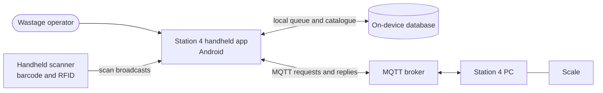

<div align="center">
  
  <h1>PPNAM Station 4 handheld app</h1>
  <p>
    The Android app that wastage operators at PPNAM carry on a handheld scanner at Station 4.<br>
    It registers each bag of waste by scanning it, and asks the Station 4 PC to weigh the bag on the station's scale.<br>
    Built by Systems One.
  </p>
</div>

<p align="center">
  
  &nbsp;&nbsp;&nbsp;&nbsp;
  <picture>
    <source media="(prefers-color-scheme: dark)" srcset="docs/assets/systems-one-dark.png">
    
  </picture>
</p>

<p align="center">
  <a href="https://github.com/Systems-One/PPNAM_Station_4_AA/releases/latest">Latest release (APK)</a>
  &nbsp;|&nbsp;
  <a href="#documentation">Documentation</a>
  &nbsp;|&nbsp;
  <a href="docs/sop/PPNAM_Station_4_Handheld_SOP.pdf">Operator SOP (PDF)</a>
  &nbsp;|&nbsp;
  <a href="docs/README-Wastage-Bag-Process-Flow.md">Wastage bag process flow</a>
  &nbsp;|&nbsp;
  <a href="CLAUDE.md">Repo rules and MQTT notes</a>
</p>

## Contents

- [What it does](#what-it-does)
- [What the system can do](#what-the-system-can-do)
- [How it fits together](#how-it-fits-together)
- [Status](#status)
- [Get started](#get-started)
- [Install or deploy](#install-or-deploy)
- [Documentation](#documentation)
- [Repository layout](#repository-layout)

## What it does

A wastage operator signs in on the handheld, scans a waste bag, and records which job it came
from, who filled it and what kind of waste it holds. The handheld sends that record to the
Station 4 PC. When the bag reaches the station's scale, the operator scans it again and the
Station 4 PC weighs it and records the weight against the operator.

- Registers a bag in five scanned or typed steps, with a review before anything is sent.
- Keeps registered bags on the handheld until Station 4 confirms them, so a network gap does not lose a bag.
- Asks Station 4 to weigh a registered bag and shows the weight it recorded.
- Shows on every screen whether the network link and the Station 4 PC are reachable.

It does not weigh anything itself (only the Station 4 PC is wired to the scale), it cannot edit
or delete a collection once Station 4 has accepted it, and it does not print labels or reports.

## What the system can do

### Handheld app

Built. The 279 JVM unit tests pass (run locally on 2026-11-27 with `testDebugUnitTest`). The
on-device behaviour below is taken from the operator SOP and the source; it was not re-checked
on a device for this README.

| Area | Capability |
|---|---|
| Sign in | Username and password, or an RFID badge scan on the Log In screen. The password is never sent as typed: sign-in uses a SCRAM-SHA-256 challenge and proof exchanged with Station 4. |
| Sign in | The username list comes from Station 4 and is kept on the handheld, so it is available while the station is offline. |
| Session | Automatic sign-out after 15 minutes without a touch or scan (configurable, 0 = never, up to 1440). Station 4 can also end a session. |
| Waste Collection | Five steps: bag code, job number, production operator's card, waste category, waste type. Steps 1 to 3 accept a scan or manual entry. |
| Waste Collection | The operator's card is looked up at Station 4 and the returned name is shown; the step only advances on an accepted answer. |
| Waste Collection | Local checks refuse blank values, control characters, values over 100 characters and placeholder values such as `N/A`. |
| Waste Collection | Review card with an Edit button per row before the collection is sent. |
| Offline queue | Each confirmed collection is saved in a local database first, then sent. Queued collections are resent when the link returns, or at once with **Retry now**. |
| Offline queue | Collections still queued at log out are not sent under the next person's sign-in; the next person is told to capture them again. |
| Weigh Bag | Scan a bag that is on the station's scale and tap **Request weight**. The station measures and the handheld shows the weight, the bag and who captured it. |
| Weigh Bag | A weigh is never queued. Only a busy, empty or unsettled scale (and a timeout or lost link) keeps the bag code for **Retry**. |
| Waste catalogue | Categories and types are synced from Station 4 and cached on the handheld. A built-in starter list is used until the first sync. |
| Connection status | A status pill on every screen: Connected, Reconnecting, Station 4 offline or Offline. Requests time out after 10 seconds. |
| Scan feedback | A success chirp or a fail buzz, each with its own vibration, once the outcome of a scan is known. |
| Settings | Diagnostics open to everyone: broker and station state, app version, device ID, catalogue age, the topic the handheld publishes to. |
| Settings | Broker host, port, WebSocket, TLS and account, and the auto sign-out time, behind a supervisor PIN with a lockout after five wrong attempts. The broker password is stored encrypted under an Android Keystore key. |
| Device identity | The device ID is derived on the handheld and every MQTT topic is derived from it. No topic can be configured. |

### Station 4 PC side

Not in this repository. The handheld depends on the Station 4 PC to answer sign-in, operator
look-up, catalogue, collection and weigh requests and to drive the scale. That software and
the MQTT contract the handheld implements live in the separate Station 4 PC repository, so
nothing about its state is verified here.

### Delivery

Built. The workflow has produced one published release, `v1.0.0`.

| Area | Capability |
|---|---|
| Release build | Pushing a `v*` tag builds the APK on GitHub Actions and publishes it as a GitHub Release named `PPNAM_Station_4_AA.apk`. |
| Signing check | The APK is signed with the shared PPNAM debug keystore held as a repository secret. The build fails if the certificate fingerprint is not the expected one, because a different signature would stop the app updating on scanners that already have it. |
| Manual build | Running the workflow by hand builds the APK as a workflow artifact without publishing a release. |
| Operator SOP | A script in the repo builds the operator SOP as one self-contained HTML file and an A4 PDF from `docs/sop/content.md`. |

## How it fits together



The handheld publishes each request on `PPNAM/station_4/{deviceId}/req/{type}` and Station 4
answers on `PPNAM/station_4/{deviceId}/res/{type}`.

| Part | What it does | Where it lives |
|---|---|---|
| Screens | Log In, Home, Waste Collection, Weigh Bag and Settings, written with Jetpack Compose | [`app/src/main/java/com/mitas/ppnam/station4aa/ui`](app/src/main/java/com/mitas/ppnam/station4aa/ui) |
| Navigation | Routes between the screens | [`app/src/main/java/com/mitas/ppnam/station4aa/navigation`](app/src/main/java/com/mitas/ppnam/station4aa/navigation) |
| Domain logic | The collection wizard, validation, refusal messages, session and inactivity rules, PIN gate, use cases | [`app/src/main/java/com/mitas/ppnam/station4aa/domain`](app/src/main/java/com/mitas/ppnam/station4aa/domain) |
| MQTT | Connection handling, topic derivation, request and reply channels, message formats | [`app/src/main/java/com/mitas/ppnam/station4aa/data/mqtt`](app/src/main/java/com/mitas/ppnam/station4aa/data/mqtt) |
| Sign-in exchange | SCRAM-SHA-256 challenge and proof | [`app/src/main/java/com/mitas/ppnam/station4aa/data/auth`](app/src/main/java/com/mitas/ppnam/station4aa/data/auth) |
| Local storage | Room database for the collection outbox and the waste catalogue | [`app/src/main/java/com/mitas/ppnam/station4aa/data/local`](app/src/main/java/com/mitas/ppnam/station4aa/data/local) |
| Scanner input | Receives barcode and RFID reads broadcast by the handheld's scanner service | [`app/src/main/java/com/mitas/ppnam/station4aa/data/rfid`](app/src/main/java/com/mitas/ppnam/station4aa/data/rfid) |
| Settings and secrets | Saved settings, PIN lockout state, encrypted broker password | [`app/src/main/java/com/mitas/ppnam/station4aa/data/settings`](app/src/main/java/com/mitas/ppnam/station4aa/data/settings), [`data/security`](app/src/main/java/com/mitas/ppnam/station4aa/data/security) |
| Unit tests | JVM tests for the domain, MQTT, storage and view-model logic | [`app/src/test`](app/src/test) |
| Device tests | Instrumented tests that need an emulator or handheld | [`app/src/androidTest`](app/src/androidTest) |
| Release workflow | Builds, checks the signature and publishes the APK | [`.github/workflows/release.yml`](.github/workflows/release.yml) |

## Status

| Part | State |
|---|---|
| App version | `1.0.0`, version code 10 ([`app/build.gradle.kts`](app/build.gradle.kts)). |
| Latest release | `v1.0.0`, published 2026-11-26. It is the only tag in the repository. |
| Unit tests | 279 tests in 36 test files, all passing when run locally on 2026-11-27. |
| Device tests | 4 instrumented tests in 2 files (one is the Android Studio example test). Not run for this README. |
| Continuous integration | The only workflow builds and releases the APK. It does not run the tests. |
| Released build type | The release workflow ships the debug build (`assembleDebug`). A minified `release` build type is defined but is not what gets published. |
| Operator SOP | Written for app version 1.5.0 (7), dated 2026-11-06. The app has since been renumbered to 1.0.0, so the version shown in the SOP and its screenshots does not match the current build. |
| Waste categories | Awaiting customer confirmation. Until a handheld syncs with Station 4, it lists every waste type under one provisional category, "Uncategorised". |
| Default broker account | The app ships with a shared default broker account so a new handheld connects without setup. The source comment says handhelds should get their own scoped broker account before this leaves a development deployment. |
| Working with Station 4 | Depends on the Station 4 PC software in another repository. Not verified from this repository. |

## Get started

You need:

- Android Studio or the Android SDK (compile SDK 35), with the SDK path in `local.properties`.
- A JDK. [`gradle.properties`](gradle.properties) pins `org.gradle.java.home` to a JDK 21 at a Windows path; change it or override it with `-Dorg.gradle.java.home=...` if yours is elsewhere. The release workflow builds with JDK 17 this way.
- A device or emulator running Android 8.0 (API 26) or later to run the app.

The Gradle wrapper (Gradle 8.7) is in the repository.

```bash
# run the unit tests (no device or network needed)
./gradlew testDebugUnitTest

# build the debug APK: app/build/outputs/apk/debug/app-debug.apk
./gradlew assembleDebug
```

> [!WARNING]
> A fresh install is preconfigured to connect to a real MQTT broker. Running the app on a
> device or emulator with network access connects to it and can send sign-in, collection and
> weigh requests to a live Station 4. Point it at a test broker in Settings first, and read
> the rollout notes in [`CLAUDE.md`](CLAUDE.md) before pointing a handheld at a live broker.

> [!WARNING]
> An APK you build locally is signed with your own debug keystore unless you have the shared
> PPNAM one. It will not install over the app already on a provisioned scanner.

## Install or deploy

1. Open the [latest release](https://github.com/Systems-One/PPNAM_Station_4_AA/releases/latest) and download `PPNAM_Station_4_AA.apk`.
2. Install the APK on the handheld. It is signed with the shared PPNAM keystore, so it updates the copy already installed. This repository does not document an install method.
3. Open the app from the **Station 4** tile in the PPNAM Station Launcher and wait for the status pill to show **Connected**.
4. If the pill stays **Offline**, a supervisor checks the broker settings in Settings (PIN required).
5. Sign in, open Settings and tap **Refresh catalogue** once, so the handheld has the real waste categories and types.

To publish a new version, raise `versionCode` and `versionName` in
[`app/build.gradle.kts`](app/build.gradle.kts) and push a `v*` tag. The workflow does the rest.

## Documentation

| I want to | Read |
|---|---|
| Use the app as an operator or supervisor | [Operator SOP (PDF)](docs/sop/PPNAM_Station_4_Handheld_SOP.pdf) or the [HTML version](docs/sop/PPNAM_Station_4_Handheld_SOP.html) |
| Look up an on-screen message and what to do about it | [SOP source, "Messages and what to do"](docs/sop/content.md) |
| Edit the SOP text | [`docs/sop/content.md`](docs/sop/content.md) |
| Rebuild the SOP, or understand its template | [`docs/sop/_template/README.md`](docs/sop/_template/README.md) |
| Understand the agreed wastage bag process | [Wastage bag process flow](docs/README-Wastage-Bag-Process-Flow.md) |
| Understand the MQTT rules this app follows and why | [`CLAUDE.md`](CLAUDE.md) |
| See the design of the scan-driven collection wizard | [Spec](docs/superpowers/specs/2026-08-05-scan-driven-waste-wizard-design.md), [plan](docs/superpowers/plans/2026-08-05-scan-driven-waste-wizard.md) |
| See how collection results were aligned with Station 4 | [Plan](docs/superpowers/plans/2026-08-05-waste-collection-result-alignment.md) |
| See the design of the phase 1 wastage bag flow | [Spec](docs/superpowers/specs/2026-09-02-phase-1-wastage-bag-flow-design.md), [plan](docs/superpowers/plans/2026-09-02-phase-1-wastage-bag-flow.md) |
| See the design of RFID badge login | [Spec](docs/superpowers/specs/2026-09-18-rfid-badge-login-design.md), [plan](docs/superpowers/plans/2026-09-18-rfid-badge-login.md) |
| See the UI audit fixes | [Plan](docs/superpowers/plans/2026-10-02-ui-audit-fixes.md) |
| See how releases are built | [`.github/workflows/release.yml`](.github/workflows/release.yml) |

The MQTT contract between the handheld and Station 4 is not in this repository. It is kept
with the Station 4 PC software.

## Repository layout

| Folder or file | What is in it |
|---|---|
| [`app/`](app) | The Android app: source, resources, unit tests and device tests. |
| [`assests/`](assests) | Source artwork: icon files and logo images. The folder name is spelled this way in the repository. |
| [`docs/`](docs) | The process flow, the operator SOP and its template, design specs and plans. |
| [`docs/assets/`](docs/assets) | Logos used by this README. |
| [`gradle/`](gradle) | The Gradle wrapper and the dependency version catalogue ([`libs.versions.toml`](gradle/libs.versions.toml)). |
| [`.github/`](.github) | The release workflow. |
| [`build.gradle.kts`](build.gradle.kts), [`settings.gradle.kts`](settings.gradle.kts), [`gradle.properties`](gradle.properties) | Gradle build configuration. |
| [`CLAUDE.md`](CLAUDE.md) | Repo rules and notes on the MQTT contract. |
